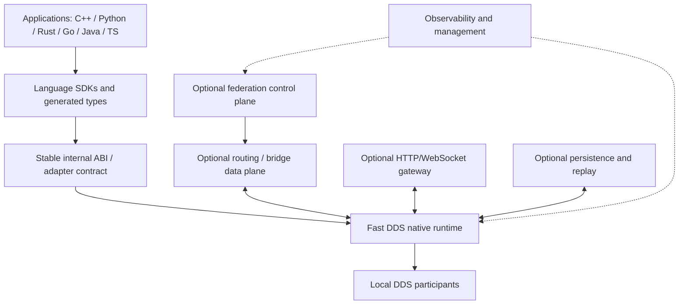

# Архитектура D2S Platform

**Статус:** Proposal; реализованных компонентов в репозитории на момент создания документа нет.



## Компоненты и ответственность

### Native Core

Адаптер к Fast DDS: жизненный цикл DomainParticipant, Topic, Publisher/Subscriber, DataWriter/DataReader; обработка ошибок и конфигурация QoS. Вариант реализации — C++ с отдельным стабильным C ABI для bindings. Стабильность ABI является задачей D2S, а не обещанием Fast DDS.

### SDK Layer

Тонкий высокоуровневый API, не навязывающий низкоуровневые детали большинству приложений. Ресурсы должны закрываться детерминированно. SDK не должны придумывать несовместимые wire-форматы.

### Schema Tooling

Единое описание типов на DDS IDL, генерация моделей и проверка совместимости. Отдельный план для динамической типизации и schema evolution.

### Local Networking

Штатное DDS Discovery (SIMPLE или другой поддерживаемый режим), транспорт и QoS. Прямая коммуникация там, где сетевые условия позволяют. Стандартные DDS-ограничения остаются в силе.

### Federation (deferred)

Граф логических доменов, обнаружение ограниченного числа соседей, поиск допустимого маршрута, авторизованный обмен между изолированными DDS-сетями. **Федерация не равна DDS DomainId** и не входит в нативный стандарт DDS как описанный нами механизм.

### Optional Services

Routing/bridge, web access, record/replay, diagnostics. Они опциональны для local core; отдельные функции могут требовать их развёртывания.

## Два сетевых режима

| Свойство | Local | Federation (будущий) |
|---|---|---|
| Обнаружение | Нативный DDS | Локальный DDS + overlay соседей |
| Маршрутизация | Непосредственная доступность DDS peers | Разрешённые междоменные маршруты |
| Состояние графа | Не требуется | Локальное, ограниченная видимость |
| Центр управления | Не обязателен | Не предполагается обязательный |
| NAT и Internet | Не гарантируются | Требуют отдельных адаптеров/реле |
| Доставка | DDS QoS | DDS QoS + семантика мостов, оговаривается отдельно |

## Инварианты проектирования

- Отсутствие Federation Service не мешает standalone LAN работе.
- Каждый публичный SDK должен проходить общий interop contract test.
- Восстановление соединения не означает восстановления всей потерянной истории.
- Нет несанкционированной междоменной передачи даже при физической связности.
- Браузерный JS/TS подключается через gateway; прямой DDS из браузера не предполагается.
- Слой Federation не должен требовать полной глобальной топологии.
- Ошибки сети, QoS incompatibility и ошибки сериализации должны быть наблюдаемы.

## Минимальная структура будущего исходного кода (proposal)

```text
core/             # C++ Fast DDS integration
include/d2s/      # публичные заголовки и внутренний C ABI
schema/           # IDL examples and code generation
sdk/python/
sdk/rust/
sdk/go/
sdk/cpp/
sdk/java/
sdk/typescript/
services/         # gateways, persistence, federation adapters
tests/interop/
tests/faults/
docs/
```

Структура отражает границы модулей, а не обязательное решение о monorepo: отдельные SDK могут получить собственные репозитории при развитии проекта.
