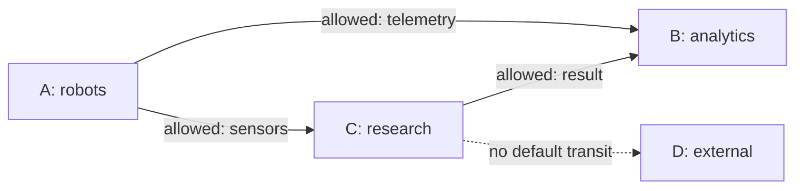

# RFC: федерация логических доменов — граф с ограниченной видимостью

**Статус:** Proposal, deferred до стабильного local core.  
**Ключевые решения:** [ADR-0002](adr/0002-limited-visibility-graph.md), [ADR-0003](adr/0003-identity-and-domains.md).

## Мотив

Иерархия `Global:A:B:C` удобна для организационного дерева, но распределённые системы нередко образуют граф: один сервис взаимодействует с несколькими организациями, а связи могут меняться. Поэтому логические домены не обязаны иметь одного родителя или формировать единую иерархию.

Федерация D2S моделируется ориентированным графом G=(V,E):

- **V** — логические домены с независимыми идентичностями и политиками.
- **E** — разрешённые направленные междоменные отношения (не обязательно постоянное физическое соединение).
- **Транспортная топология** и **граф прав** хранятся/проверяются отдельно.

## Limited visibility

Домен знает своих непосредственных соседей, но не обязан хранить карту всей федерации. Допускается получать агрегированные объявления о достижимости в пределах прав и искать маршруты по запросу. Соседство **не даёт** права читать данные и **не разрешает** транзит автоматически.



Диаграмма — отношения политик в примере, не обязательные физические потоки.

## Default deny

Любое междоменное действие требует явного разрешения для источника, назначения, направления и набора Topics/типов. Поиск маршрута и наличие транзитного узла **не расширяют** разрешений. Транзитная передача A→C→B не допускается автоматически даже при разрешениях A→C и C→B.

**Минимальная модель правила (черновик):**

```yaml
# Proposal, not working platform config
allow:
  source_domain: robots
  destination_domain: analytics
  topics: ["robot.telemetry"]
  actions: ["forward"]
  max_hops: 3
```

Окончательная семантика требует уточнения: кто подписывает правило, кто может его отзывать, нужна ли санкция обеих сторон, и где хранить доказательство авторизации.

## Без центральной обязательной точки

Ни «глобальный корень», ни центральный discovery/broker не являются обязательными. Узлы могут образовывать соседства добровольно. В то же время bootstrap до первого соседа, выпуск доверенных идентичностей, получение маршрутов через NAT и работа при разделении сети требуют определённой политики, а не магии P2P.

## Изоляция и отказоустойчивость

- Отказ одного peer не останавливает обмен между другими доступными узлами без зависимости от этого peer.
- Домен, лишённый всех допустимых маршрутов, закономерно недоступен извне.
- Ограниченная видимость не означает секретность метаданных сама по себе: информацию нужно минимизировать, а запросы и ответы авторизовать.
- Кэши маршрутов инвалидируются по TTL/version и состоянию соседства.
- Маршруты и политики должны защищаться от циклов, подмены и бесконтрольного широковещания.

## Не выбирать архитектуру на веру

Перед реализацией федерации сравнить с более простым вариантом: Fast DDS + стандартные partitions / ACL + существующий DDS Router. Нужны измеримые преимущества по связности, управлению политиками или эксплуатации; при отсутствии преимуществ проект может остаться локальной библиотекой + gateway.
